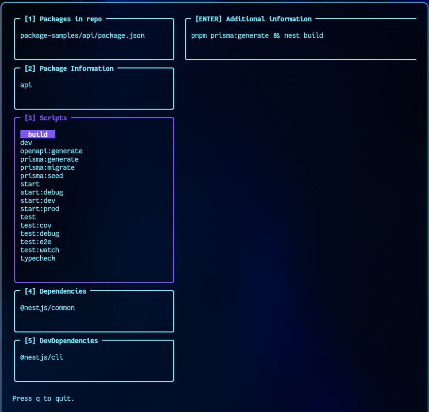

# Lazynpm
[](https://pkg.go.dev/github.com/Elcris1/lazynpm)
[](https://goreportcard.com/report/github.com/Elcris1/lazynpm)
[](https://opensource.org/licenses/MIT)

A terminal user interface (TUI) for managing packages, scripts, and dependencies inside Node managed projects.

[](https://github.com/Elcris1/lazynpm)

## Purpose of the project
I wanted to learn go in order to explore my preferences in the dev world and get closer to programming languages that require the developer to take memory management into depeper consideration.    
Even though that the utility of the tool is very limited, I wanted to explore the Go ecosystem and decided to embark in completely new adventure from what I am used to: TUI developing. 

## Dev useful commands

Module init

```bash
go mod init github.com/Elcris1/lazynpm
```

Adding dependencies

```bash
go get -u github/username/pacakge@version
```

Synchronizyng dependencies

```bash
# sync and clean module cache
go mod tidy

# Download explicit packages
go mod download
```

Building the packages

```bash
go buid -o bin/lazynpm ./cmd/lazynpm/
```

Running the built in project

```bash
./bin/lazynpm 
```

System wide installation of package

```bash
go install ./cmd/lazynpm
```

## Dev Notes

This will be written as we go, learning things

# How to use lazynpm

This wil be written whenever there is something to explain
